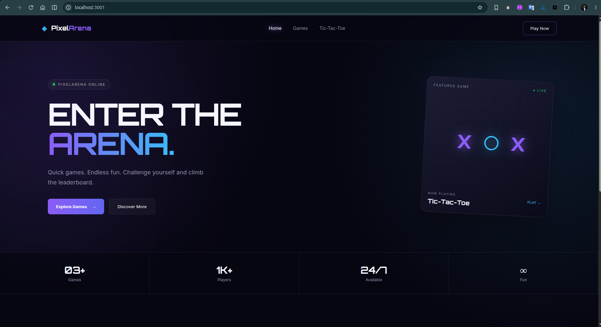
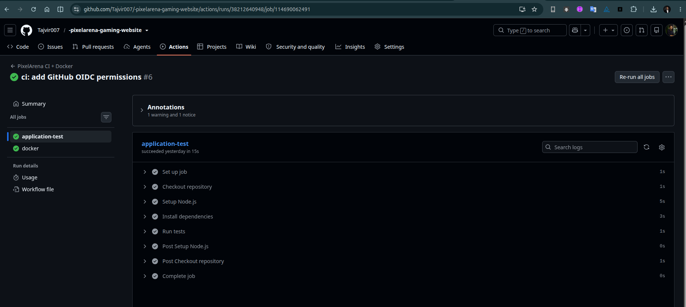
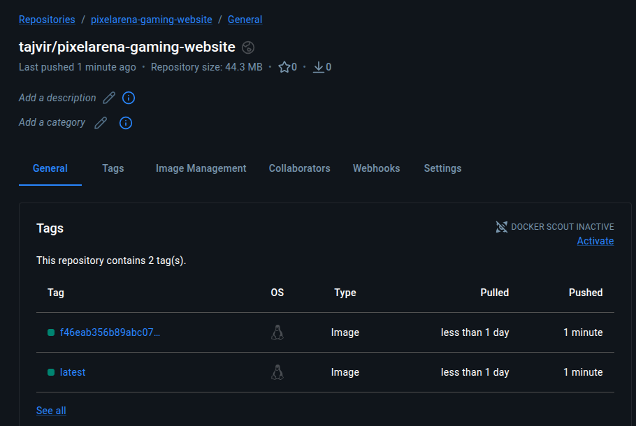
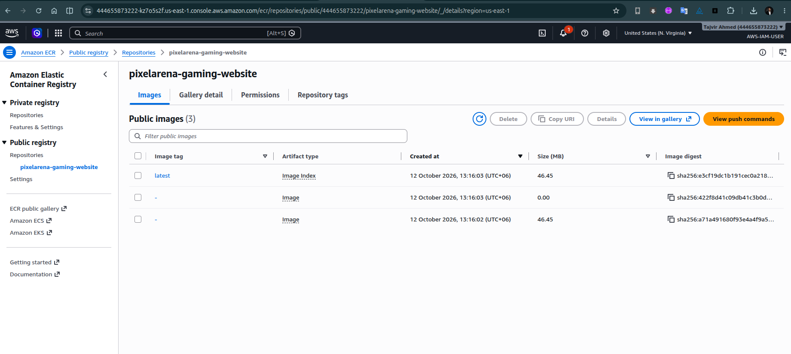
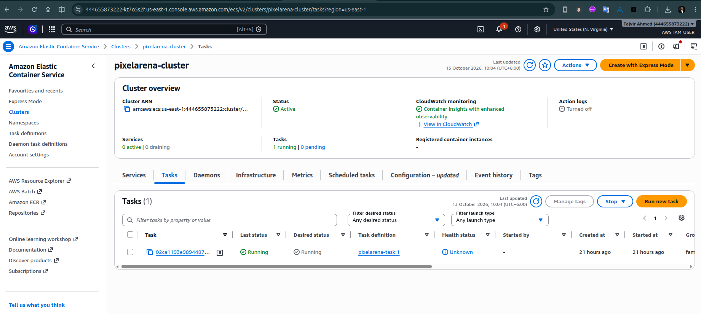

# PixelArena — Gaming Website | DevOps CI/CD Project

A containerized gaming website deployed through a DevOps workflow using GitHub Actions, Docker, and AWS.

**Project Type:** DevOps / CI/CD / Cloud Deployment  
**Application:** Node.js + Express.js  
**Containerization:** Docker  
**CI/CD:** GitHub Actions  
**Cloud Platform:** AWS  
**Status:** Local application tested; Docker and GitHub Actions configured; AWS ECR/ECS deployment documented below.

---

## Table of Contents

1. [Project Overview](#1-project-overview)
2. [Project Objectives](#2-project-objectives)
3. [Technology Stack](#3-technology-stack)
4. [Architecture](#4-architecture)
5. [Project Workflow](#5-project-workflow)
6. [Project Structure](#6-project-structure)
7. [Prerequisites](#7-prerequisites)
8. [Local Setup](#8-local-setup)
9. [Git and GitHub Setup](#9-git-and-github-setup)
10. [GitHub Actions CI/CD](#10-github-actions-cicd)
11. [Docker Setup](#11-docker-setup)
12. [Docker Hub Image Publishing](#12-docker-hub-image-publishing)
13. [AWS Deployment](#13-aws-deployment)
14. [IAM and GitHub OIDC](#14-iam-and-github-oidc)
15. [Amazon ECR](#15-amazon-ecr)
16. [Amazon ECS](#16-amazon-ecs)
17. [Application Load Balancer](#17-application-load-balancer)
18. [Screenshots](#18-screenshots)
19. [Verification and Testing](#19-verification-and-testing)
20. [Troubleshooting](#20-troubleshooting)
21. [Security Best Practices](#21-security-best-practices)
22. [Project Progress Tracker](#22-project-progress-tracker)
23. [Future Improvements](#23-future-improvements)

---

## 1. Project Overview

PixelArena is a gaming website built with Node.js and Express.js. This project is also used to practice DevOps engineering concepts by building an automated software delivery workflow.

The main goal is to understand how application code moves from a developer's local machine to a container registry and then to AWS.

The project covers source code management, automated testing, Docker image creation, image publishing, AWS container deployment, load balancing, and deployment verification.

### Application Features

- Gaming website interface.
- Express.js web server.
- Static file serving.
- Games API endpoint.
- Health check endpoint.
- Docker containerization.
- Automated testing with GitHub Actions.

### API Endpoints

| Endpoint | Purpose |
|---|---|
| `/` | Serves the website |
| `/api/games` | Returns available game information |
| `/api/health` | Returns application health status |

Expected health check response:

```json
{
  "status": "ok"
}
```

The application listens on port `3001` by default.

---

## 2. Project Objectives

The objectives of this project are:

- Manage application source code using Git and GitHub.
- Run and test the application locally.
- Containerize the application using Docker.
- Automate tests using GitHub Actions.
- Build and publish Docker images to Docker Hub.
- Configure AWS IAM permissions for deployment.
- Use GitHub OIDC to authenticate GitHub Actions with AWS without storing long-lived AWS access keys.
- Store deployment images in Amazon ECR.
- Deploy the application using Amazon ECS.
- Expose the application through an Application Load Balancer.
- Maintain deployment documentation and troubleshooting records.

---

## 3. Technology Stack

| Category | Technology |
|---|---|
| Application | Node.js |
| Web Framework | Express.js |
| Version Control | Git |
| Source Code Hosting | GitHub |
| CI/CD | GitHub Actions |
| Containerization | Docker |
| Local Container Testing | Docker CLI |
| Container Registry | Docker Hub, Amazon ECR |
| Cloud Platform | AWS |
| Identity and Permissions | AWS IAM |
| CI/CD Authentication | GitHub OIDC |
| Container Orchestration | Amazon ECS |
| Traffic Distribution | Application Load Balancer |
| Logging and Monitoring | Amazon CloudWatch |

---

## 4. Architecture

### High-Level Architecture

```text
Developer
    |
    | Git commit and push
    v
GitHub Repository
    |
    v
GitHub Actions
    |
    +----------------------+
    |                      |
    v                      v
Install and Test      Build Docker Image
                           |
                           v
                     Docker Hub
                           |
                           v
                  AWS Deployment Workflow
                           |
                    GitHub OIDC / IAM
                           |
                           v
                     Amazon ECR
                           |
                           v
                       Amazon ECS
                           |
                           v
                Application Load Balancer
                           |
                           v
                     Gaming Website
```

**Note:** Docker Hub publishing and AWS ECR publishing are separate registry operations. If both are performed automatically by GitHub Actions, both steps must be configured in the workflow.

### AWS Network Architecture

```text
                         Internet
                            |
                            v
                    Application Load
                       Balancer
                    (Public Subnets)
                            |
                            v
                      Target Group
                            |
                            v
                       Amazon ECS
                    (Private Subnets)
                            |
                            v
                    PixelArena Container
                       Port 3001
```

This is the intended network design. The exact subnet placement and ECS launch type should match the AWS resources configured in your account.

---

## 5. Project Workflow

The project is developed and deployed in the following order.

### Step 1 — Local Development

Develop the application and verify that it runs correctly on the local machine.

### Step 2 — Git and GitHub

Commit the source code and push it to the GitHub repository.

### Step 3 — Continuous Integration

GitHub Actions automatically runs the configured workflow when a push or pull request triggers it.

The workflow installs dependencies and runs application tests.

### Step 4 — Docker Build

Build a Docker image containing the application and its runtime dependencies.

### Step 5 — Docker Hub Publishing

Authenticate to Docker Hub using GitHub Actions secrets and push the image to the configured repository.

### Step 6 — AWS Authentication

Use GitHub OIDC and an AWS IAM role to allow the deployment workflow to access authorized AWS resources.

### Step 7 — Amazon ECR

Authenticate to Amazon ECR and publish the image required by the AWS deployment.

### Step 8 — Amazon ECS

Configure an ECS task definition and service to run the container image.

### Step 9 — Application Load Balancer

Route incoming HTTP or HTTPS requests through the load balancer to healthy application targets.

### Step 10 — Verification

Verify the GitHub Actions workflow, container image, ECS service, load balancer endpoint, and application health endpoint.

---

## 6. Project Structure

```text
pixelarena-gaming-website/
├── .github/
│   └── workflows/
├── css/
├── js/
├── docs/
│   └── screenshots/
├── server.js
├── package.json
├── package-lock.json
├── Dockerfile
├── .dockerignore
├── .gitignore
└── README.md
```

The exact files and directories depend on the current repository version.

---

## 7. Prerequisites

Install or configure the following tools before starting:

- Git
- Node.js and npm
- Docker Engine or Docker Desktop
- GitHub account
- Docker Hub account
- AWS account
- AWS CLI for AWS-side verification and administration

Verify the installed tools.

**Run these commands:**

```bash
git --version
node --version
npm --version
docker --version
docker compose version
aws --version
```

The AWS CLI is required only for the AWS-related steps. GitHub Actions can use OIDC to authenticate independently.

---

## 8. Local Setup

### Step 1 — Clone the Repository

**Run this command:**

```bash
git clone https://github.com/Tajvir007/-pixelarena-gaming-website.git
```

### Step 2 — Enter the Project Directory

**Run this command:**

```bash
cd -pixelarena-gaming-website
```

If the directory already exists locally, enter the existing project directory instead.

### Step 3 — Install Dependencies

**Run this command:**

```bash
npm ci
```

`npm ci` installs the dependencies defined by the lockfile. If the project does not contain `package-lock.json`, use `npm install` to generate it.

### Step 4 — Start the Application

**Run this command:**

```bash
npm start
```

If the project does not define a `start` script, check `package.json` and use its configured entry point.

### Step 5 — Open the Application

Open the following address in a browser:

```text
http://localhost:3001
```

### Step 6 — Test the Health Endpoint

**Run this command in another terminal:**

```bash
curl -i http://localhost:3001/api/health
```

Expected result: HTTP 200 with a JSON response containing `"status": "ok"`.

### Step 7 — Stop the Application

Press `Ctrl+C` in the terminal running the application.

---

## 9. Git and GitHub Setup

### Check the Repository

**Run these commands:**

```bash
git status
git branch --show-current
git remote -v
```

### Stage and Commit Changes

**Run these commands:**

```bash
git add .
git commit -m "docs: add project documentation"
```

### Push to GitHub

**Run this command:**

```bash
git push origin main
```

Pushing to `main` triggers the GitHub Actions workflows configured for that branch.

---

## 10. GitHub Actions CI/CD

GitHub Actions automates application testing and container publishing.

The workflow is stored inside:

```text
.github/workflows/
```

### CI Workflow Responsibilities

1. Check out the repository.
2. Set up Node.js.
3. Install dependencies.
4. Run automated tests.
5. Build the Docker image.
6. Publish the image when the publishing workflow and credentials are configured.

### GitHub Actions Secrets

For Docker Hub publishing, configure the following repository secrets:

| Secret | Purpose |
|---|---|
| `DOCKERHUB_USERNAME` | Docker Hub username |
| `DOCKERHUB_TOKEN` | Docker Hub access token |

Never store passwords, access tokens, or AWS secret keys directly in workflow files.

### How to Verify CI

1. Push a commit to `main`.
2. Open the GitHub repository.
3. Select **Actions**.
4. Open the latest workflow run.
5. Verify the job logs and final status.

A successful run should show all required jobs and steps completing successfully.

---

## 11. Docker Setup

### Step 1 — Build the Image

Run this command from the project root containing the Dockerfile.

**Run this command:**

```bash
docker build -t pixelarena-gaming-website:local .
```

### Step 2 — Verify the Image

**Run this command:**

```bash
docker images
```

### Step 3 — Run the Container

**Run this command:**

```bash
docker run -d \
  --name pixelarena-local \
  -p 3001:3001 \
  -e PORT=3001 \
  pixelarena-gaming-website:local
```

### Step 4 — Verify the Container

**Run these commands:**

```bash
docker ps
docker logs pixelarena-local
curl -i http://localhost:3001/api/health
```

### Step 5 — Stop and Remove the Container

**Run these commands:**

```bash
docker stop pixelarena-local
docker rm pixelarena-local
```

If the container name already exists, remove or rename the existing container before running a new one.

---

## 12. Docker Hub Image Publishing

GitHub Actions uses repository secrets to authenticate to Docker Hub and publish the image.

The expected flow is:

```text
Git Push
   |
   v
GitHub Actions
   |
   v
Docker Build
   |
   v
Docker Hub Login
   |
   v
Push Image
```

Verify that the expected image exists in Docker Hub.

If you have configured the repository name and image tag, pull the image using the actual image reference.

**Command template:**

```bash
docker pull <DOCKERHUB_USERNAME>/pixelarena-gaming-website:<TAG>
```

Replace the placeholders with your actual Docker Hub username and published tag.

---

## 13. AWS Deployment

The AWS deployment uses IAM, Amazon ECR, Amazon ECS, and an Application Load Balancer.

### Deployment Order

1. Verify the AWS account and region.
2. Configure IAM and GitHub OIDC.
3. Configure VPC, subnets, routes, and security groups.
4. Create the ECR repository.
5. Configure ECS cluster and task execution permissions.
6. Configure the task definition.
7. Create or update the ECS service.
8. Configure the target group and Application Load Balancer.
9. Configure the GitHub Actions deployment workflow.
10. Verify the application through the load balancer.

### AWS CLI Verification

**Run these commands:**

```bash
aws sts get-caller-identity
aws configure get region
```

Verify that the returned account and region match the intended AWS environment.

### Deployment Design

- **IAM:** Controls which AWS actions the deployment workflow and ECS tasks can perform.
- **OIDC:** Allows GitHub Actions to request short-lived AWS credentials through an IAM role.
- **ECR:** Stores the Docker image consumed by ECS.
- **ECS:** Runs and maintains the application containers.
- **ALB:** Receives client traffic and forwards requests to healthy targets.
- **CloudWatch:** Can collect container logs and operational metrics.

AWS resource names, ARNs, network IDs, and deployment settings should be documented using the actual values from the AWS account.

---

## 14. IAM and GitHub OIDC

GitHub OIDC avoids the need to store long-lived AWS access keys in GitHub repository secrets.

The workflow assumes an IAM role whose trust policy permits the intended GitHub repository and branch.

### Security Requirements

- Restrict the OIDC trust policy to the intended repository.
- Restrict branch access to `main` when that is the deployment branch.
- Grant only the AWS permissions needed for the deployment.
- Keep the ECS task execution role separate from the GitHub deployment role.
- Use a separate ECS task role only when the application itself needs AWS API access.
- Never commit AWS credentials or session tokens.

Record the following in the AWS documentation:

- IAM role name.
- OIDC provider configuration.
- Trust policy conditions.
- Permissions policy.
- GitHub repository and branch restrictions.

Do not publish credential values or sensitive configuration.

---

## 15. Amazon ECR

Amazon Elastic Container Registry stores the image used by ECS.

### Image Publishing Flow

```text
GitHub Actions
      |
      v
Docker Build
      |
      v
Amazon ECR
      |
      v
Amazon ECS
```

### Verify the AWS Identity and Region

**Run these commands:**

```bash
aws sts get-caller-identity
aws configure get region
```

### Authenticate Docker to ECR

Replace the placeholders with your actual AWS account ID and region.

**Run this command:**

```bash
aws ecr get-login-password --region <AWS_REGION> \
  | docker login \
      --username AWS \
      --password-stdin <AWS_ACCOUNT_ID>.dkr.ecr.<AWS_REGION>.amazonaws.com
```

### Tag and Push an Image

These commands assume the ECR repository already exists and the local image has been built.

**Run these commands:**

```bash
docker tag pixelarena-gaming-website:local \
  <AWS_ACCOUNT_ID>.dkr.ecr.<AWS_REGION>.amazonaws.com/<ECR_REPOSITORY>:latest
```

```bash
docker push \
  <AWS_ACCOUNT_ID>.dkr.ecr.<AWS_REGION>.amazonaws.com/<ECR_REPOSITORY>:latest
```

### Verify the Published Image

**Run this command:**

```bash
aws ecr describe-images \
  --repository-name <ECR_REPOSITORY> \
  --region <AWS_REGION>
```

For CI/CD deployments, prefer an immutable image tag such as a Git commit SHA rather than relying only on `latest`.

---

## 16. Amazon ECS

Amazon ECS runs the container image stored in ECR.

### Main ECS Components

- **Cluster:** Logical grouping for ECS workloads.
- **Task Definition:** Defines the container image, port mappings, resources, and roles.
- **Task:** A running instance of a task definition.
- **Service:** Maintains the desired number of running tasks and can integrate with an ALB.
- **Task Execution Role:** Allows ECS to pull images from ECR and send logs to CloudWatch when configured.
- **Task Role:** Grants AWS permissions to the application only when required.

### Deployment Procedure

1. Create or select the ECS cluster.
2. Register a task definition referencing the ECR image.
3. Configure container port `3001`.
4. Configure the task execution role.
5. Create or update the ECS service.
6. Attach the ALB target group.
7. Wait for the service to reach a stable state.
8. Verify task health and application responses.

### Verify the ECS Service

**Command template:**

```bash
aws ecs describe-services \
  --cluster <ECS_CLUSTER> \
  --services <ECS_SERVICE> \
  --region <AWS_REGION>
```

Check the service's running task count, deployment status, and reported events.

---

## 17. Application Load Balancer

The Application Load Balancer exposes the application through a stable AWS DNS endpoint.

### Traffic Flow

```text
Client Browser
      |
      v
ALB Listener
      |
      v
Target Group
      |
      v
Healthy ECS Task
      |
      v
Express Application
Port 3001
```

### Health Check

Configure the target group's health check path as:

```text
/api/health
```

The expected successful response is HTTP 200.

### Security Group Design

- ALB security group: allow inbound HTTP/HTTPS as required.
- ECS task security group: allow application traffic on port `3001` from the ALB security group.
- Avoid exposing the ECS application port directly to the entire internet.
- Configure HTTPS with an appropriate certificate for production use.

### Verify the Application

After the ALB is active and its targets are healthy, use its actual DNS name.

**Run this command:**

```bash
curl -i http://<ALB_DNS_NAME>/api/health
```

If HTTPS is configured, use the HTTPS URL.

Open the ALB endpoint in a browser to test the website.

---

## 18. Screenshots

Screenshots provide evidence that each stage was implemented and tested.

Save screenshots inside `docs/screenshots/` and use relative paths so they display on GitHub.

### 18.1 Local Application



Shows the website running locally on port `3001`.

### 18.2 GitHub Actions



Shows the workflow run and successful test/build/publish steps.

### 18.3 Docker Image



Shows the local Docker image and its tag.

### 18.4 Amazon ECR



Shows the ECR repository and the published image tag.

### 18.5 Amazon ECS



Shows the cluster, service status, running tasks, and deployment state.

### 18.6 Application Load Balancer


Shows the application accessed through the ALB endpoint.

**Screenshot guideline:** Replace these placeholder references with actual screenshots captured from your environment. Do not use a successful-looking screenshot to represent a stage that has not been verified.

---

## 19. Verification and Testing

### Local Application

**Run these commands:**

```bash
curl -i http://localhost:3001/api/health
curl -i http://localhost:3001/api/games
```

### Git Repository

**Run these commands:**

```bash
git status
git log -5 --oneline
```

### Docker

**Run these commands:**

```bash
docker ps
docker images
docker logs pixelarena-local
```

### AWS

Verify the following in the AWS Console or CLI:

- IAM role and OIDC trust policy.
- ECR image and tag.
- ECS cluster and service.
- Running task count.
- Task definition and container port.
- ALB listener and target group.
- Target health.
- Application health endpoint.
- CloudWatch logs, if configured.

---

## 20. Troubleshooting

| Problem | What to check |
|---|---|
| `npm ci` fails | Lockfile, Node.js version, dependency errors |
| Port `3001` is in use | Existing application or container |
| Docker permission denied | Docker daemon status and user permissions |
| GitHub Actions fails | Workflow YAML, job logs, secrets, permissions |
| Docker Hub authentication fails | Username, access token, repository permissions |
| ECR push fails | AWS identity, region, ECR permissions, repository name |
| ECS tasks fail to start | Task definition, image URI, execution role, logs |
| ECS tasks cannot pull images | ECR permissions and network connectivity |
| ALB target is unhealthy | Health path, port mapping, security groups, app response |
| Website times out | ALB listener, target health, routes, security groups |

When fixing an issue, document the original error, its cause, the solution, and the verification command.

---

## 21. Security Best Practices

- Use GitHub secrets for sensitive CI/CD credentials.
- Prefer OIDC over long-lived AWS access keys.
- Restrict IAM permissions using least privilege.
- Pin or review GitHub Actions versions according to your security policy.
- Avoid embedding credentials in Docker images.
- Exclude `.env` files and secrets from Git.
- Use immutable image tags for traceable releases.
- Restrict ECS task access to the ALB security group.
- Enable appropriate CloudWatch logs and operational monitoring.
- Review AWS costs and remove unused resources after practice.

---

## 22. Project Progress Tracker

| Milestone | Status |
|---|---|
| Application runs locally | Completed |
| Source code stored in GitHub | Completed |
| GitHub Actions CI | Configured; verify current run |
| Docker image builds locally | Completed |
| Docker Hub publishing | Configured; verify current run |
| AWS IAM and OIDC | Verify final trust and permissions |
| Amazon ECR | Verify repository and image |
| Amazon ECS | Verify service and running tasks |
| Application Load Balancer | Verify endpoint and healthy targets |
| End-to-end deployment workflow | Verify automated image-to-ECS deployment |
| Documentation and screenshots | In progress |

Update this table only when the relevant stage has been tested successfully.

---

## 23. Future Improvements

- Add automated linting and code coverage.
- Add Trivy container image scanning.
- Integrate SonarQube for code quality analysis.
- Add automated deployment from GitHub Actions to ECS.
- Use Terraform to provision AWS infrastructure.
- Add CloudWatch alarms and dashboards.
- Configure HTTPS using AWS Certificate Manager.
- Add rollback procedures for failed deployments.
- Add staging and production environments.
- Expand the project with additional games and application tests.

---

## Author

**Tajvir Ahmed Sejan**

Junior DevOps Engineer | DevOps and IT Support

GitHub: [Tajvir007](https://github.com/Tajvir007)

Project Repository: [PixelArena Gaming Website](https://github.com/Tajvir007/-pixelarena-gaming-website)

